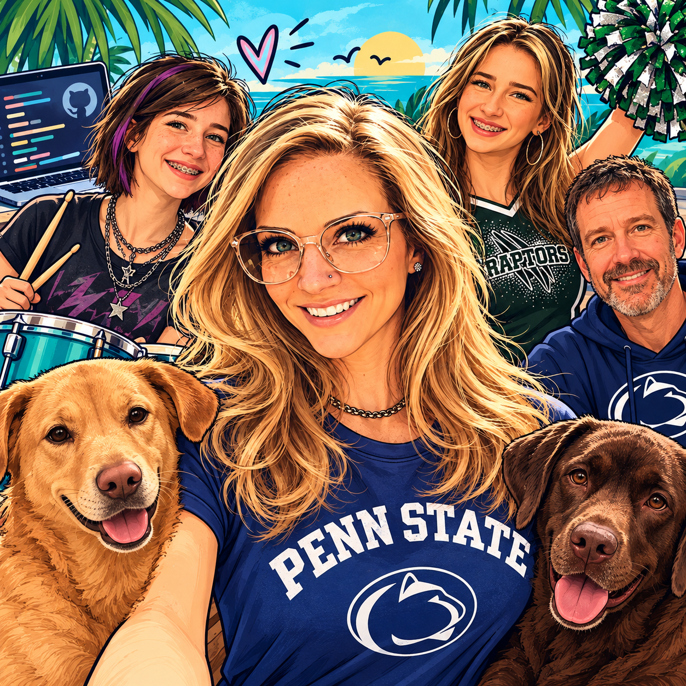

# Hi, I’m Julia 👋

Welcome! I'm a technical program manager and content developer with a 
background in business and communications. 

I’ve learned much of the technical side by finding something cool, figuring out how to do it, then showing others how to do it too. That’s how writing led me into automation, AI, and workflows.

I always wanted to work in tech. So I'm  learning my way into it. I'm not done.

> ### So, like, what even do I do?
>
> Here's where I’m collecting docs I've written, processes I’ve built, and stuff I’ve learned along the way: 
>
> [My portfolio](/portfolio/README.md)

Most of my Microsoft work happened in private repositories, so the contributions you can see here tell only a tiny part of the story. I was an active author, reviewer, and repo administrator across high-profile Microsoft Learn docsets. My portfolio connects that work to published docs and describes the systems and processes I built along the way.

