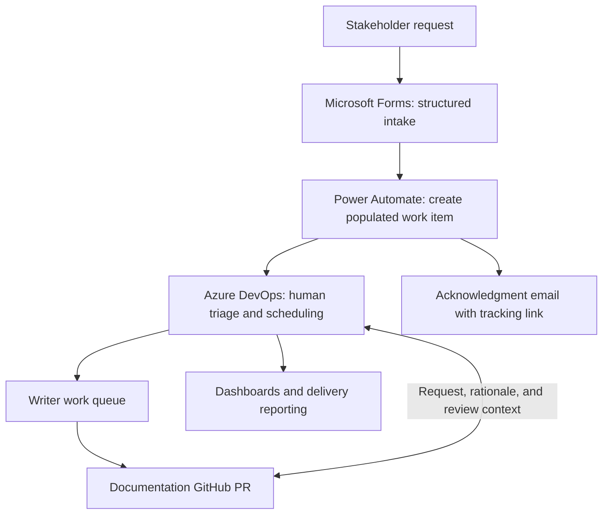

# Case study: Turning scattered requests into a durable system of work

This was one of my favorite projects because it started with a problem that kept getting in everyone's way—and became something teams continued using after I moved on.

While supporting Partner Center, Commercial Marketplace, and Microsoft Sales Experience documentation, I saw requests arrive through Teams, email, meetings, and GitHub issues. Some needed immediate attention. Some were missing important details. Others never made it into our work queue.

Stakeholders had trouble tracking requests, and writers spent time gathering information and manually creating work items before they could start the actual work.

I taught myself Power Automate and built a structured intake system connecting Microsoft Forms, Azure DevOps, acknowledgment emails, and operational reporting. I kept refining it as different teams used it, then adapted the approach for Power BI and Fabric.

## The problem behind the requests

The issue wasn't simply that we needed a form.

We needed a consistent way to capture requests, understand what was being asked, prioritize the work, and preserve the context through publication.

Without that structure:

- A conversation could end without a trackable request.
- Missing details meant follow-up messages and delays across time zones.
- Vendor writers needed additional explanation before picking up work.
- Stakeholders had to ask where things stood.
- Leadership had an incomplete picture of demand and delivery.

I wanted the information to be available when someone needed it, without depending on me to explain every request.

## What I built

### Structured intake

I created a short Microsoft Forms intake process that captured the information needed to triage, prioritize, and schedule documentation work.

The form distinguished between product-group requests, announcements, and Support requests. It prompted contributors for details we regularly had to chase down, including the requested change, announcement information, whether a technical freshness review had occurred, and whether article ownership needed updating.

That preparation mattered. A request with enough context could move into the queue ready for someone to work on it.

### Automated work-item creation and acknowledgment

I built a Power Automate flow that translated submissions into prepopulated Azure DevOps work items.

The automation used form responses to apply relevant tags and parent-work-item relationships. It also sent an acknowledgment email with a tracking link, giving the requester confirmation and a place to follow the work.

As the workflow evolved, I used Power Automate to support related operations, including updating existing work items and creating linked work across Azure DevOps projects.

The form was the entry point. The work item became the record people could use to coordinate delivery.

### A queue that supported the writing team

Structured requests made it easier for vendor writers to pick up work without a separate meeting or a long explanation from me.

I refined the work-item organization and intake process around the team's working styles and needs. That helped make assignments clearer and reduced the back-and-forth required to understand them.

The system supported human triage and prioritization. Its purpose was to make those decisions easier and better informed.

> “It gets the work to the right place with all the necessary information with less dialogue needed. It is especially easier for vendor writers to pick up work without meetings or painful delays.”
>
> — Jason H. · April 2025

### Visibility into demand and progress

I built dashboards, queries, and burndown reporting to track work and support monthly reporting to product leadership.

The intake form also made it possible to examine the kinds of requests arriving: announcements versus article changes, new content versus updates or retirement, Support versus product-group requests, and demand across workspaces.

That gave us a more useful conversation than “the team is busy.” We could discuss what was coming in, what was moving, and where attention was needed.

## Designing for Support as well as product teams

Support needed a dependable path for getting customer-facing guidance corrected.

I worked with supportability partners to make requests identifiable and trackable. Straightforward corrections needed to move quickly, while more substantial changes still needed appropriate technical review.

During February through mid-April 2024, the team received **33 Support requests through the process and completed them within 1–2 business days**. That was an observed delivery result during that period, rather than a standing service-level commitment.

The tracking also helped Support quantify documentation-related issues it was resolving. Feedback from those partners shaped further adjustments to the process.

> “The new process you have opened up for doc requests to be created efficiently has been game-changing. We now don't have to wait on the engineering PMs to make straightforward and easy updates. The speed at which these updates have been getting implemented is really great.”
>
> — Kyle M. · Senior Supportability PM · April 2024

## Keeping the reasoning attached to the change

I had also seen a recurring problem with historical documentation changes: someone would ask who requested an edit or why a statement had changed.

Git history could show the edit. It didn't always preserve the reasoning behind it.

I instituted bidirectional links between documentation pull requests and their corresponding Azure DevOps work items. The linked records preserved the original request, supporting feedback, technical direction, and review context.

That made the work easier to investigate later. A future contributor could follow the change back to its rationale instead of trying to reconstruct a conversation or find the person who remembered it.

## Making the process stick

Building the automation was only part of the work.

I made structured intake the expected path for requests and incorporated it into the product group's feature-release practices. I demonstrated the approach to colleagues, shared the flows, and helped other teams adapt it.

When Partner Center and Marketplace moved to documentation self-service, the intake system stayed in place. Product managers and vendor writers could continue using the same request process even though the ownership model had changed.

I later built a similar intake form and flow for the receiving Microsoft Sales Experience content team and adapted the approach for Power BI and Fabric.

## Building on the workflow with AI

I also began building and testing an agentic version of the intake experience in Copilot Studio, extending my work with Power Automate. This version was a conversational intake agent that could gather request details and pass a summary to the flow—a prototype for making submission easier while retaining the structured work-tracking process.

This was the next iteration of the project: exploring how AI could support the intake experience on top of the structured workflow I had already built. The Copilot Studio work was a prototype, separate from the Forms and Power Automate system already in use.

The broader evaluation approach is described in the [AI workflow evaluation
case study](ai-workflow-evaluation.md).

## Results and continued adoption

The strongest result was that the process continued to be useful after I moved on. I packaged the intake automation for team ownership and reuse, including a template other teams could adapt.

The Partner Center implementation remained in use by product managers and vendor writers after the transition to self-service. I later adapted the approach for Power BI and Fabric documentation, and the Microsoft Sales Experience content team used my form as a template for its own process. Other teams like Azure Monitoring adopted the process too.

Across these implementations, the system gave requesters a consistent entry point, writers more complete assignments, and stakeholders a shared view of the work. Its continued use through changes in staffing and ownership is the part I'm proudest of.

These are adoption snapshots from different implementations and reporting periods, rather than a single combined total.

The system gave requesters a consistent entry point, writers more complete assignments, and stakeholders a shared view of the work. Its continued use after portfolio transitions showed that it had become part of how the teams operated.

> “Thanks to Julia's efforts, the intake form has been widely adopted by PM stakeholders, enabling smoother collaboration and timely documentation requests.”
>
> — Sneha G. · October 2025

## How the pieces fit together

*Conceptual illustration of the workflow, created for this portfolio.*

## Why this project matters to me

I wasn't hired to build an intake system. I noticed a recurring problem, learned the tools to address it, and kept improving the solution with the people who used it.

What started as a way to eliminate repetitive work became a shared process for capturing demand, coordinating delivery, and preserving decisions. Seeing it continue across teams and organizational changes is the part I'm proudest of.

## Stakeholder perspectives

> “In creating the docs intake process Julia worked collaboratively to ensure both the Engineering and Docs teams needs were met. She had great input and was always to open entertain alternatives.”
>
> — Kenny D. · Senior Technical PM · October 2022

> “Julia is easy to work with. She is transparent and her goal is simply to do the right thing for our users.”
>
> — Kenny D. · Senior Technical PM · October 2022

> “You recognize there is a difference in easy versus more substantial changes and the process supports allowing us to edit quickly where we can, but also gives the space for larger changes to ensure proper governance is in place.”
>
> — Tammy G. · Senior Supportability PM · April 2024

> “Your team is also awesome at keeping on top of the requests - so much so that I thought the query was broken as there was NO backlog! I love that!”
>
> — Tammy G. · Senior Supportability PM · April 2024

> “Julia is really structured and prioritizes the intake structure through SPS Docs and pulls me into ADO/GitHub as needed so we can collaborate and iterate quickly. She is quick to provide ETAs and staging links and ask questions as needed to ship quick.”
>
> — Ananya J. · April 2025
___
*AI helped draft and refine this page. The experiences and contributions described are my own.*
