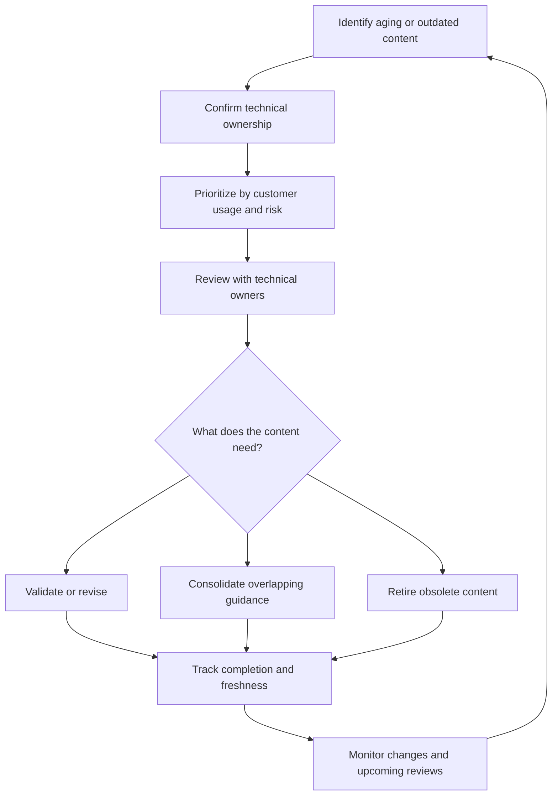
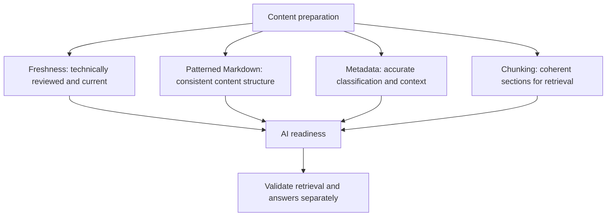

# Case study: Building a repeatable approach to freshness and AI readiness

Keeping documentation current sounds straightforward: find the old pages, ask someone to review them, and update what needs changing.

That gets harder when the portfolio spans hundreds of articles, technical ownership is distributed across product teams, and everyone has competing priorities. A list of stale pages doesn't tell you where to start—or make the reviews happen.

Starting in my first months at Microsoft, I built and refined freshness processes across Partner Center, Marketplace, Microsoft Sales Experience, and later Power BI and Fabric. Over time, that work grew from coordinating periodic reviews into an ongoing approach to prioritization, technical validation, content structure, and AI readiness.

## Starting with a process people could follow

In late 2021, I began coordinating freshness reviews for Partner Center and Marketplace documentation. I identified pages due for review, connected with their owners, and followed up on progress.

The point was to establish whether the guidance was still accurate, not simply change its date.

By April 2022, I had coordinated reviews for **285 documents** whose last-reviewed dates were more than a year old. Document owners had completed **95% of those reviews**, with the remaining work carrying into the next quarter.

During that period, freshness increased:

| Portfolio | Earlier freshness | April 2022 |
|---|---:|---:|
| Partner Center | 85.2% | 97.5% |
| Marketplace | 85.6% | 97.4% |

This gave me a foundation I could reuse: identify the content, establish ownership, organize the work, and keep following through until reviews were completed.

## Applying the approach to Microsoft Sales Experience

When I took on Microsoft Sales Experience documentation, I brought the freshness process with me.

I tracked stale content, coordinated technical reviews with product owners, and used regular reporting to make the work and its results visible. I also consolidated and retired content where maintaining another page wasn't the best answer.

Freshness reached **97.4% in October 2022** and **99% in March 2023**. By the October 2024 review period, the portfolio was maintaining **100% freshness**.

That wasn't a one-time cleanup. It required repeated attention as content aged, products changed, and ownership shifted.

> “One of your secret sauces was to push hard to simplify the portfolio and consolidate and remove several hundred pages (400+ pages) of unneeded content, so that time was not wasted refreshing unneeded pages and images.”
>
> — Jason H. · October 2022

> “We started this journey with you, when docs were in disarray without structure or process, and you've led from the front on getting us to 100% freshness.”
>
> — Siddharth V. · Principal Group Product Manager · October 2024

## Making prioritization more realistic

By spring 2023, Partner Center had a backlog of more than **650 stale pages**, and freshness had dropped to **72.7%**. Asking busy product managers to review the entire backlog wasn't producing enough progress.

I needed a more practical way to decide what deserved attention first.

I joined a Fix Hack Learn project developing a script to forecast freshness under different prioritization approaches. I used it to compare the effect of reviewing different groups of pages.

The analysis projected that:

- Without reviews, freshness would decline to about **71%**.
- Reviewing the five highest-traffic stale pages could bring it to **77.2%**.
- Reviewing the top 100 could bring it to **96.8%**.

Those were forecasts, not measured results. Their value was making the tradeoff visible: we could focus a manageable amount of technical-review effort on the pages customers used most.

Instead of presenting hundreds of overdue articles as equally urgent, I could bring stakeholders a specific, evidence-based recommendation.

> “I appreciate Julia's reports and prompts to our team, which help us hone where to focus our energy and get the biggest content bang for buck.”
>
> — Jill S. · Senior Product Manager · April 2024

## Moving beyond quarterly cleanup

I kept adjusting the process when progress slowed.

I worked with the product group's Rhythm of Business team to move freshness tracking closer to its existing work practices. A dashboard in the product managers' environment gave them visibility into their pages without waiting for my month-end report. Our team also recommended incorporating page-view weighting to help them prioritize.

I later organized follow-up around individual workspaces. I created focused group conversations with owners of stale pages and the workspace owner, giving them time to address the work before their regular leadership reviews. That made freshness something they could discuss in their own shiproom meetings.

The process became more proactive. Teams could review pages approaching their freshness threshold rather than wait for them to become overdue.

## Connecting freshness to AI readiness

When I moved to Power BI and Fabric in 2025, I applied the same approach to a different portfolio: use the available signals to identify the highest-impact work, validate the guidance with technical owners, and track progress.

I also expanded the focus beyond freshness.

Our AI-readiness metric was heavily influenced by freshness, along with patterned Markdown, appropriate metadata, and content structured into useful chunks for retrieval. These concerns were connected: guidance needed to be current, clearly organized, and represented consistently for both readers and AI experiences.

I also evaluated AI-assisted review and content-quality workflows in the context
of real documentation repositories. That related work is described in the [AI
workflow evaluation case study](ai-workflow-evaluation.md).

My work included:

- Prioritizing reviews using usage, quality, risk, and AI-retrievability signals.
- Revising high-traffic introductory guidance.
- Reducing duplicate and conflicting content.
- Improving headings, structure, metadata, and content-pattern consistency.
- Restructuring hubs, landing pages, and navigation around customer scenarios.

By October 2025, the Power BI repository had reached **90% freshness**, and I had overseen freshness reviews of **320+ articles**.

In the October 2025–April 2026 period, freshness across my owned scope increased from **74% to 90%**, while AI readiness reached **99.5%—660 of 663 topics**.

These figures describe different reporting periods and scopes; they aren't one continuous before-and-after measurement. AI readiness was also a content-quality indicator, not proof that an AI system would retrieve or answer every question correctly.

## What changed in how I approached the work

Across these portfolios, I learned that freshness depends on more than finding old dates.

It needs technical ownership, a manageable set of priorities, visibility into progress, and a regular rhythm of follow-through. It also needs judgment about whether to revise, consolidate, or retire content.

I built the process, refined the tracking and prioritization, and kept the work moving. Product managers, engineers, peer writers, and vendors contributed technical reviews and updates. The portfolio results came from that combined effort.

The most useful outcome was a repeatable way to keep improving: identify what needs attention, understand its customer impact, agree on the next work, and check whether it gets done.

> “For even more impact, you could evangelize your excellent best practices of freshness with the Content Health PM team [...] to go beyond our organization or host a day of learning session on how to systematize content maintenance. The Skilling department has a lot to learn about scaling out large maintenance efforts.”
>
> — Jason H. · October 2022

## Why it matters

Freshness and AI readiness both depend on treating documentation as a maintained system.

This work shows how I turn a broad quality goal into practical operations: clear ownership, evidence-based priorities, recurring review, and measurable progress. I carried that approach across different products and teams, adapting it as the portfolios—and the ways customers consumed the content—changed.

## Stakeholder perspectives

> “The aspect that you doubled down on was being proactive via teams / email and other comms to cajole an over worked PM community to do the right thing for our users. We valued the partnership and will miss it going forward.”
>
> — Siddharth V. · Principal Group Product Manager · October 2024

> “1) Your allyship and proactive approach to problem solving. 2) Leading by example 3) Willingness to lean in and roll up your sleeves to get the job done.”
>
> — Siddharth V. · Principal Group Product Manager · October 2024

> “I started interacting with Julia a few months ago when she reached out to me about the accuracy of the billing content. She is adaptable, accommodating, and cautious about what we share externally.”
>
> — Sourish D. · Senior PM, Partner Center · April 2022

> “She goes over the facts and ties up any loose ends. I'm delighted to be working with her and look forward to collaborating on future projects.”
>
> — Sourish D. · Senior PM, Partner Center · April 2022

> “We sure do appreciate the amazing partnership and look forward to our ongoing collaboration to enhance the in-product support experience for our partners and to keep the health score... Healthy!”
>
> — Ken W. · September 2023

> “Love the metric-driven approach…”
>
> — Vamsee K. · Senior PM · October 2022

> “Customer obsessed and highly metric driven”
>
> — Vamsee K. · Senior PM · October 2022

*Microsoft maintains the live documentation, which may have changed since my involvement.*
