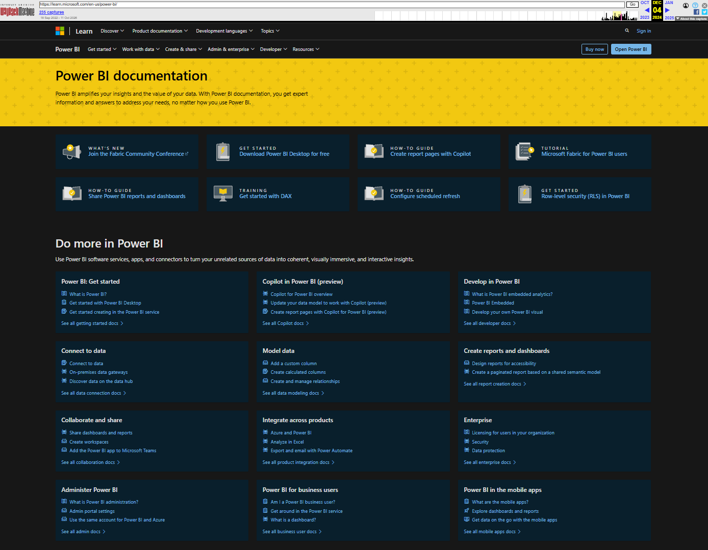
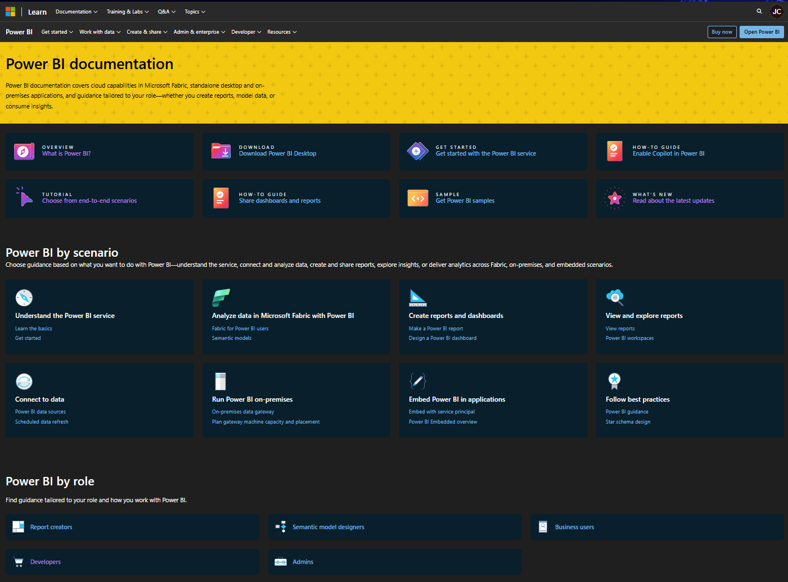

# Case study: Reorganizing the Power BI documentation hub around scenarios and roles

**Role:** Senior Content Developer  
**Focus:** Information architecture, customer experience, and documentation navigation  
**Period:** 2025–2026

## The challenge

The Power BI documentation hub brought together guidance for a broad product ecosystem and audiences with different needs.

The earlier experience mixed tasks, audiences, product areas, and deployment options in one navigation grid. Categories such as connecting to data and creating reports appeared alongside enterprise guidance, developer documentation, mobile apps, and business-user content.

The opportunity was to make the choices more explicit: help visitors navigate by what they wanted to accomplish, their role, or the tool they needed.

## My contribution

I contributed to restructuring the Power BI hub and supporting navigation as part of broader improvements to the documentation experience.

I collaborated with the information-architecture v-team on Power BI’s organization and relationship to the Fabric ecosystem. My work also included improvements to tables of contents and landing pages, revisions to introductory guidance, and identification and reduction of overlapping content.

The hub comparison illustrates a concrete result of this work: clearer separation between customer scenarios, audience roles, and tools.

## What changed

### Navigation by scenario

The revised hub introduces “Power BI by scenario,” with paths for understanding the service, connecting to data, creating reports and dashboards, viewing reports, analyzing Fabric data, running Power BI on-premises, embedding analytics, and following best practices.

An introductory sentence explains how to use the section. This gives visitors a task-oriented starting point without requiring them to understand the documentation’s internal organization.

### Navigation by role

A separate “Power BI by role” section provides another way into the content, including paths for semantic model designers and administrators.

Separating roles from scenarios makes the two navigation approaches explicit. Visitors can start with either their responsibility or the task in front of them.

### More purposeful featured links

The revised featured area surfaces end-to-end tutorials, samples, getting-started guidance, sharing, Copilot enablement, and product updates.

These links provide direct entry points to practical guidance and learning resources before visitors explore the broader documentation.

### Clearer tools and deployment choices

The revised “Power BI tools and deployment options” section explains the purpose of components such as Desktop, Report Builder, Report Server, Mobile, gateways, and Embedded.

Fabric guidance appears within the scenario navigation. The hub therefore connects related technologies to customer activities while keeping the page focused on Power BI.

## Evidence and results

Archived screenshots show the change from mixed navigation categories to explicit scenario, role, and tool sections.

### Before

### After

My April 2026 performance review records improvements to the hub, landing pages, and tables of contents as part of work to improve scenario-based discoverability. My manager independently confirms those structural contributions.

The screenshots demonstrate the delivered design changes. They do not establish a measured improvement in task completion, navigation speed, or engagement. Broader content-quality results from this period reflect multiple initiatives and are not attributed to the hub alone.

## What this demonstrates

- Organizing a complex documentation experience around customer tasks and audiences.
- Connecting hub design with supporting navigation and article-level improvements.
- Making product and deployment relationships easier to interpret.
- Collaborating on information architecture across a large content portfolio.

*Archived capture dates do not represent exact deployment dates. Microsoft maintains the live documentation, which may have changed since my involvement.*

___
*AI helped draft and refine this page. The experiences and contributions described are my own.*
