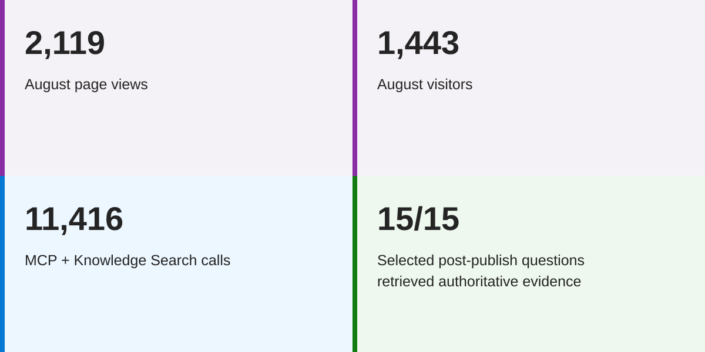

# Case study: Power BI Premium to Microsoft Fabric migration guidance

Moving from Power BI Premium to Fabric meant customers had a lot of questions: What was changing? Which capacity did they need? What would happen to their existing workloads? And what did they actually need to do?

I authored four connected Microsoft Learn articles to help customers work through those questions and complete the migration. Within the project, I filled the **knowledge engineer** role: drafting the guidance, working through technical reviews with SMEs across teams, filling gaps, and refining the wording until the pieces worked together.

## What we delivered

- [Migration overview](https://learn.microsoft.com/power-bi/support/premium-migration-overview) — the overall journey and what customers could expect.
- [Decision guide](https://learn.microsoft.com/power-bi/support/premium-migration-decision-guide) — choosing a SKU, right-sizing, and deciding whether to change regions.
- [Migration how-to](https://learn.microsoft.com/power-bi/support/premium-migration-how-to) — inventory, pilot, reassignment, validation, and decommissioning.
- [Migration FAQ](https://learn.microsoft.com/power-bi/support/premium-migration-faq) — answers to common questions and blockers.

## The challenge

Customers needed different information depending on where they were in the process. Someone trying to understand the change needed a different starting point from an administrator ready to move workspaces.

The four articles needed to stand on their own while also working as a set. That meant keeping the terminology, instructions, caveats, and links consistent—and making sure customers could find their next step without piecing the process together themselves.

## My contribution

I drafted the customer-facing content and managed the review process with SMEs across teams. There were multiple rounds of revisions: incorporating feedback, asking follow-up questions, filling gaps, and fine-tuning wording where a small distinction could change what a customer understood or did.

I also worked through consistency across the set. An explanation in the overview needed to agree with the decision guide, and the procedures needed to account for the exceptions described in the FAQ.

Strategy, analysis, and evaluation were handled by other project members. My part was turning the input into clear guidance and working through the technical details with the people who could validate them.

## An AI learning that stuck with me

During development, an upstream AI assistant suggested July 31 as an internal first-draft target. Somewhere in the handoff to a work item, that context disappeared. The drafting assistant then turned it into a "customers must migrate by July 31" deadline.

I initially trusted the work item, too. An SME questioned the date during review, and we confirmed that there was no universal migration deadline.

I corrected the guidance and documented what happened and how we resolved it in both the linked work items and the documentation pull request.

The lesson: a statement can sound perfectly reasonable and still be wrong. Passing it through multiple AI-assisted steps doesn't validate it—it can just make the original misunderstanding harder to spot. Dates and requirements need a source, and an internal planning target needs to stay clearly labeled as one through every handoff.

## Why this work matters

Good migration guidance helps customers understand the change, make decisions for their environment, and follow through without losing important details along the way.

This project brought together the parts of the work I enjoy: learning the technical details, finding the gaps, asking questions, and working with people across teams to make something useful.

## Early results

In August, the first full month after publication, the four articles received **2,119 page views from 1,443 visitors**. The overview led direct traffic, with 622 views and 453 visitors.

The project closeout reported **11,416 combined MCP and Knowledge Search calls**. The FAQ led machine retrieval, with 1,809 Learn MCP calls and 2,016 Knowledge Search calls. In post-publication Learn MCP testing, **all 15 selected high-volume customer questions retrieved authoritative evidence with the required caveats**.

Before publication, the team had analyzed 25 customer questions to identify gaps in the existing guidance. That was a different exercise from the later retrieval test, so the two aren't a before-and-after pass-rate comparison.

August migration-related support cases were **43% below the April–June monthly average and 33% below July**. That was encouraging, but the analysis couldn't tell us how much of the decline came from the documentation versus other factors.

These were results for the team's guidance set, which I authored and took through SME review.

## Published work

The four articles are linked above.

*Microsoft maintains the live documentation, which may have changed since my involvement.*